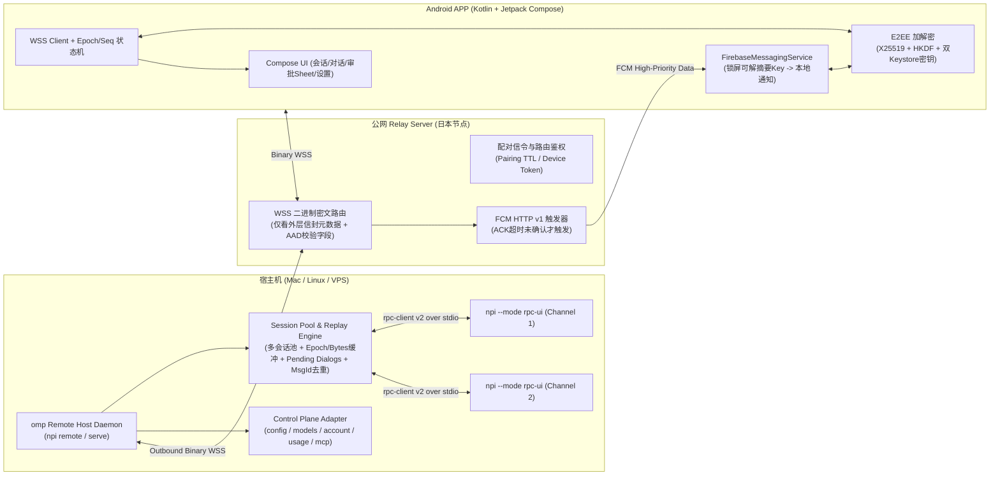

# NPi Android Remote Connect 与远程控制架构规划

- 日期：2026-11-13
- 维护仓库：NPi-Kernel（`omp/` 独立仓库；Relay 与服务端/协议适配均不在 NPi Desktop 根仓库中维护）
- 规划基线分支：`kernel.2.0.10-universal`
- 状态：规划草案（已由 `OpusPlanReviewer` 对照 `omp/` 源码完成一轮架构与安全评审并完成修订；尚未实施）

---

## 1. 目标与威胁模型

构建类似 **Claude Code Remote Connect** 的 Android 薄客户端系统：手机端**不运行 Agent、不执行本地工具、不保存模型凭据**，仅承担远程对话、模型/思考切换、工具审批与问答、设置修改及 Google GMS / FCM 推送唤醒。

### 支持范围

1. **两种部署拓扑统一安全与协议标准**：
   - **模式 A（Remote Connect / 遥控本地主机）**：Agent 运行在用户的开发机（Mac / Linux），Host Daemon 主动**出站**连接公网 Relay Server（WSS），无需开发机具备公网 IP 或端口映射。
   - **模式 B（服务器直连）**：Host Daemon 直接部署在用户的公网服务器上，Android 客户端通过 WSS 连接。**模式 B 暴露在公网下，必须强制使用与模式 A 相同的设备认证与端到端加密（不允许降级为明文）。**
2. **Android 端核心能力**：
   - 多主机 / 受控项目目录浏览 / 历史会话管理（列表、新建、恢复、重命名、分叉/中断）。
   - 实时流式对话（增量 Markdown、思考过程、工具卡片状态、队列 `steer` / `follow_up`、图片压缩附件）。
   - 远程交互决策（`select` 工具审批含后续 `hunks`、`confirm`、`input`、`editor`、`ask` 多题表单、后续扩展 `ui.present` Generative UI）。
   - 模型与推理控制（切换可用模型、思考等级、`fast` / `slow` 模式、多角色排班 `modelRoles`）。
   - 设置与运维管理（按 `profile` 读写配置、审批模式切换、订阅账号切换与额度查看、MCP 服务开关）。
   - **GMS Push（FCM）**：全链路位于日本网络环境，原生使用 FCM 高优先级 `data` 消息进行后台唤醒与本地解密通知。

### 明确的非目标与为什么不直接复用 `collab/`

- **不在手机本地运行 `omp`、Bun、LLM 或文件工具**。
- **不暴露桌面独占硬件/宿主能力**：`computer_use`（桌面键鼠/屏幕录制）、`dictation`（宿主机麦克风）、`live_start` / `live_connect`（宿主机语音）。
- **不直接复用 `omp/packages/coding-agent/src/collab/` 作为远程底座**：`collab/`（`GuestFrame`、`snapshot-chunk`、单一房间共享密钥、write-token）面向“交互式 TUI 会话临时邀人旁观/协作”，不支持无头多会话调度、模型/角色切换、配置/账号控制面、`delta` 流及基于设备公钥的吊销机制；本方案仅借鉴 `collab/relay-client.ts` 的 WSS 心跳、退避重连与背压控制思路，面向子进程侧则直接复用已支持 v2 分块重组的 `rpc-client.ts`。

### 威胁模型与安全边界（必须前置明确）

- **核心前提**：一台已配对的 Android 设备一旦获准发指令与审批工具，实质上等价于**拥有宿主机当前用户的 Shell 与文件写入能力**。
- **默认最小权限原则**：
  - 远程会话通道实行**显式白名单**，默认拒绝绕过审批的原始命令（如 `bash`）、写任意路径或改变宿主桥接的命令。
  - 远程新启动会话**禁止**继承 schema 默认的 `yolo`，必须显式锁定为 `write` 或 `always-ask`。
  - 敏感控制面操作（如切换至 `yolo`、修改 `tools.approval.*`、开关会拉起本地命令的 `mcp`、修改全局 `config`）在手机端需触发系统生物识别/解锁校验，并在宿主机写入本地审计日志。

---

## 2. 总体架构



### 职责划分原则

1. **Daemon 负责多路复用与可靠性，内核保持单会话纯粹**：`omp` 的 `rpc-mode.ts` 保持单会话 stdin/stdout 职责；新增的 **Remote Host Daemon** 在其之上统一处理多 `cwd` 会话池、字节/时间有界缓冲、`pendingDialogs` 状态重建、`msgId` 幂等去重及每设备 E2EE 加解密。
2. **Relay 仅作无明文路由与推送信使**：不存储会话记录、源码、配置明文，也不持有终端用户的 E2EE 会话密钥；手机设备的最终信任锚点在 **Host Daemon 本地的授权公钥表** 中（吊销设备立即在宿主机密码学失效，即使 Relay 被攻破或未及时断流也无法解密或通过宿主机验签）。

---

## 3. 现有 RPC 能力核对与必须修补的内核/Daemon 缺口

| 领域 | `omp/` 源码真实行为（已逐文件核对） | 本方案处理方式与需要补齐的改动 |
|---|---|---|
| **协议握手与订阅** | `rpc-mode.ts:2691-2697` 要求 `set_event_filter` 的 `events` 必须为 `null` 或非空字符串数组；子 Agent 默认订阅为 `"off"` | Daemon 拉起每个子进程后强制发送：`negotiate_protocol(2)`、`set_event_filter({ events: null, messageUpdates: "delta" })`、`set_subagent_subscription({ level: "progress" })`、`set_ask_dialog({ enabled: true })` |
| **帧大小与编码开销** | `rpc-frame.ts` 仅对 stdout 分块（上限 1 MiB / 重组 64 MiB）；`claimRpcInput` / `readLines` 无硬性分块重组；Base64 图片套 JSON 再套 Base64 密文约有 **1.78x** 膨胀 | WSS 传输层使用 **Binary Frame**（与 `collab` 相同思路，避免外层密文二次 Base64）；对上行图片限制编码前尺寸并在 Envelope 层支持分块或限定单次输入 < 700 KB；下行由 Daemon 对齐移动端分片与安全重组上限（远低于 64 MiB） |
| **断线补帧与重连** | `rpc-mode.ts:3011-3012` 在 `isStreaming || isCompacting` 时调用 `get_messages_page` 会直接返回 `session_busy`；`delta` 模式下单回合可达数千帧 | **1)** 每个 Daemon 启动与子进程拉起分配唯一 `streamEpoch`，结合 `seq` 检测断层；**2)** 缓冲按**字节上限 + 时间窗口**管理，存储前合并连续 `text_delta`；**3)** 溢出触发 `sync_reset` 时，若会话忙碌则先读 `get_state` + `get_messages`（best-effort 快照）或 `get_entries({ since })`，待下一个 `message_end` 对账完整消息 |
| **审批 / `ask` 状态恢复** | `get_state.pendingUi` **仅涵盖 `ui.present`**（`wire/state.ts:160-179`），普通工具审批与 `ask` 不在其中；关闭 stdin 会立即拒绝所有未决弹窗（`rpc-mode.ts:3257`） | Daemon 在缓冲之外独立维护 **`pendingDialogs` 状态表**（收到 `extension_ui_request` 入表，发送应答或收到 `method: "cancel"` 出表）；重连/Attach 时全量重发；存在未决弹窗或 `!isSettled` 时**严禁**休眠子进程 |
| **审批请求结构与工具关联** | `wire/frames.ts:180-262` 中无 `hunks` method，分块审批是 `select` 请求附带可选 `hunks?: ApprovalHunk[]`；超时/中断会发 `method: "cancel"`；现有请求缺少 `toolCallId` / `toolName` | 客户端严格按 `Select/Confirm/Input/Editor/Ask/Cancel/...` 完整分派并回传精确选项标签；**内核小改**：在工具审批 `extension_ui_request` 中补充可选字段 `toolCallId`、`toolName`、`tier`，让加密摘要不再靠并发下有歧义的 `tool_execution_start` 猜测 |
| **命令去重与多设备应答** | `rpc-mode.ts` 对重复 `id` 的 `prompt` / `steer` 不去重；`extension_ui_response` 无确认回执，迟到或重复 ID 被静默忽略 | Daemon 维护有限时间窗口的 `(deviceId, msgId) -> response` 幂等缓存；任一设备完成 UI 应答后，Daemon 向所有在线设备广播合成事件 `ui_resolved { requestId, byDeviceId }`，触发其他端自动收起弹窗并清理通知 |
| **会话锁（Lease）与通道 ID** | `session-manager.ts:1117-1142` 在首次写入时才抢占租约，冲突时不损坏文件也不支持只读，而是**静默另存为新文件并切换 `sessionId`**；且 `new_session` / `fork` / `switch_session` 都会改变内核 `sessionId` | **1)** Envelope 的 `sessionId` 改为 Daemon 分配的稳定 **`channelId`**（绑定进程通道）；**2)** 监听 `notice { source: "session-persistence" }` 与 `get_state.sessionFile` 变化，发生冲突分叉时立即提示手机端；**3)** 不承诺不存在的“只读模式” |
| **审批模式（4 种）与运行时生效** | 实际存在 4 种：`always-ask`、`always-ask-cached`、`write`、`yolo`（`flag-tables.ts:258`）；`--approval-mode` 启动参数会挂载运行时 override 阻塞文件监听；schema 默认值是危险的 `yolo` | **内核小改**：新增 `set_approval_mode` RPC（内部调用 `cfgToolsApprovalMode.override(...)`），远程子进程统一用它注入默认 `write` 或 `always-ask`，避免重启丢未决弹窗，也不污染用户本地全局 `config.yml`；UI 明确提示 `always-ask-cached` 会跨会话持久化到 `approval-cache.db` |
| **禁用桌面独占工具** | 在 prompt 中输入 `/computer on` 会直接触发 `applyComputerUseToggle`（`slash-commands/builtin-modes.ts:647-668`） | **内核小改**：增加不可被 `/computer` 或 RPC 覆盖的宿主强制禁用标记（如启动环境/参数锁定关闭 `computer_use`、`live`、`dictation`） |
| **项目目录 (`cwd`) 与模型前置发现** | `open_session.sessionDir` 是会话存储目录而非项目 `cwd`；`cwd` 在进程启动时由 `--cwd` 固定；无会话时调不了 `get_available_models`；`npi usage` 无 `--force` 参数 | Daemon 暴露受白名单限制的目录列表接口并按 `cwd` 复用/新建子进程；无会话时调用 `npi models --json` 列出可用模型；刷新额度复用 `npi usage invalidate` + `npi usage --json --redact`（与 Desktop `model_config.rs` 一致） |
| **配置与多角色控制面** | `orderedSettings()` 位于 `config/all-settings.ts:98`；脱敏判断应使用 `setting.isCredential`；`cli/config-cli.ts` 的 `set` 目前仅支持全局层且 `get` 不脱敏；`modelRoles` 包含 `getKnownRoleIds()` 定义的全量角色 | Daemon 直接调用内部 `Settings` / `orderedSettings()` API（不透传未脱敏 `config get`），支持传 `profile` 参数；按需补齐 project 层写入并严格过滤 `isCredential` 项；角色列表从 `getKnownRoleIds()` 动态获取 |
| **远程 OAuth 登录** | `rpc-mode.ts` `login` 会向客户端发 `open_url`（其 `launchUrl` 指向宿主机 loopback） | 默认禁止远程执行 `login`/`logout`（建议在宿主机完成登录）；若二期开放远程登录，需仅限无 loopback 依赖的 Device-Code 或手动粘贴回调码流程 |

---

## 4. 协议与安全规范

### 4.1 密码学与设备配对（已实现：`src/remote/pairing.ts`、`crypto.ts`）

所有二进制密钥/随机数在 JSON 中以 **base64url（无填充）** 传输；X25519 公钥在线上一律用 **32 字节原始公钥**（宿主内部存 SPKI DER，前缀 `302a300506032b656e032100`）。MAC 一律为 `HMAC-SHA256(key, JSON.stringify(parts))`，`parts` 为纯字符串数组。HKDF 一律为 SHA-256、输出 32 字节。

1. **配对（一次性二维码 + ECDH + 双端 SAS 确认）**：
   - `npi remote pair --relay <base>` 或 `--listen host:port [--public-url ws://…]` 生成 offer，终端打印二维码与 `npi-remote://pair?p=<base64url(JSON)>`：
     `{ v:1, mode:"relay"|"direct", url, hostId, hostPub, pairingId, secret, exp }`（`secret` 32 字节，`exp` 毫秒时间戳，默认 5 分钟）。
   - 手机连接 `${url}/ws/pair?role=device&pairingId=…`（JSON 文本帧）。`parts(label) = ["npi-remote-pair-v1", label, hostId, pairingId, hostPub, deviceId, deviceName, devicePub]`。
     1. 手机 → `pair.hello { pairingId, deviceId, deviceName, devicePub, mac=HMAC(secret, parts("hello")) }`（`deviceId` 由手机生成，`[A-Za-z0-9_-]{8,64}`）。
     2. 宿主校验 MAC 后 → `pair.challenge { mac=HMAC(secret, parts("challenge")) }`；双方计算 `shared = X25519`，`pairKey = HKDF(shared, salt=secret, "npi-remote-v1/pair-key")`，`SAS = HMAC(HKDF(shared, secret, "npi-remote-v1/sas"), parts("sas"))` 前 4 字节 `& 0x7fffffff % 1e6`（6 位补零）。
     3. 手机用户确认 SAS → `pair.confirm { mac=HMAC(pairKey, parts("confirm")) }`；或 `pair.cancel`。
     4. 宿主终端也确认后生成 `deviceToken`，落盘 `{ deviceId, name, publicKeyDerBase64, tokenHash=sha256hex(token), pairedAt }`，→ `pair.accept { sealed }`，`sealed = [12B 随机 nonce][AES-256-GCM(pairKey, AAD=JSON(parts("accept")), {"deviceToken"})][16B tag]`。任一方拒绝/超时 → `pair.reject { reason }`。
   - 未见过二维码的 Relay 既无法注入设备（缺 `secret`），也无法读取 `deviceToken`（缺 `pairKey`）。设备表位于 `<agentDir>/remote-devices.json`（0600，原子写），同时保存宿主 `relayHostToken`。
2. **静态密钥与每连接会话密钥**：
   - 静态（随配对固定，跨重启/锁屏可用）：`salt = utf8(hostId + "\0" + deviceId)`，`helloAuth / notification / collapseKey = HKDF(shared, salt, "npi-remote-v1/hello-auth" | "npi-remote-v1/notification-summary" | "npi-remote-v1/collapse-key")`。
   - 每次连接先握手：手机发 `kind:"hello"`（明文载荷 `{ deviceNonce, mac=HMAC(helloAuth, ["npi-remote-v1/hello", hostId, deviceId, msgId, deviceNonce]) }`，`deviceNonce` 32 字节）；宿主回 `kind:"welcome"`（`{ hostNonce, mac=HMAC(helloAuth, ["npi-remote-v1/welcome", hostId, deviceId, msgId, deviceNonce, hostNonce]) }`）。手机必须校验 welcome MAC。
   - 会话密钥：`salt = deviceNonce ‖ hostNonce`，`K_host_to_dev / K_dev_to_host = HKDF(shared, salt, "npi-remote-v1/session/host-to-device\0<hostId>\0<deviceId>" | ".../device-to-host\0…")`，双方计数器从 0 开始；宿主拒绝重放的 `deviceNonce`；任一方向计数器达到 `2^32` 时宿主丢弃会话并发 `rehello`。
   - 宿主对无会话设备的密封帧回 `kind:"rehello"`（无载荷）；手机收到即重新 `hello`。断线、Relay 报告设备离线、设备被吊销时会话立即作废。
3. **加密、Nonce 与 AAD**：
   - 会话帧：`[8B 计数器 BE][4B 随机][密文][16B tag]`，计数器即发送方会话计数器；接收方先认证再进入 64 位滑动重放窗口（伪造帧不会消耗计数器）。
   - AAD = `JSON.stringify({ v, hostId, deviceId, kind, channelId, streamEpoch, seq, msgId, chunk })`，**严格按此键序**，缺省字段写 `null`，`chunk` 为 `{ id, index, count }` 或 `null`；`pushHint` 不进 AAD。
   - 推送摘要 `cipherSummary`：静态 `notification` 密钥 + **12 字节全随机 nonce**，AAD = `JSON.stringify({ v:1, hostId, deviceId, channelId, requestId, seq })`，base64url。

### 4.2 传输信封（Binary WSS Frame，已实现：`src/remote/protocol.ts`）

二进制帧：`[4B headerLen BE][UTF-8 JSON Header][载荷]`，单帧 ≤ 1 MiB、Header ≤ 64 KiB。明文 > 256 KiB 时拆成多帧（每帧独立加密，Header 带 `chunk`），最多 128 片（重组上限 32 MiB，60 秒未齐丢弃）；`pushHint` 只放在首片。

```jsonc
// JSON Header（明文可见部分，仅含路由与推送信号）
{
  "v": 1,
  "hostId": "host_…",
  "deviceId": "dev_…",
  "kind": "hello" | "welcome" | "rehello" | "push" | "control" | "session" | "heartbeat" | "app_state" | "ack",
  "channelId": "ch_…",           // Daemon 分配的稳定通道 ID，非易变内核 sessionId
  "streamEpoch": 3,              // 子进程/Daemon 世代号
  "seq": 142,                    // 下行单调序号
  "msgId": "01J…",               // 上行请求唯一 ID（幂等缓存；回复沿用同一 msgId）
  "chunk": { "id": "…", "index": 0, "count": 3 },
  "pushHint": {                  // 仅下行关键帧携带
    "category": "approval" | "ask" | "done" | "error" | "dismiss",
    "requestId": "ui-req-99",
    "collapseKey": "<hmac-prefix>", // 脱敏哈希，不向 Google 暴露真实 sessionId
    "pendingCount": 1,
    "cipherSummary": "<base64url>"
  }
}
```

- `control` / `session` 请求必须带 `msgId`，回复载荷统一为 `{ ok: true, result } | { ok: false, error }`（`session` 的 `result` 是内核 RPC 原始 response）。重复 `msgId` 直接返回缓存结果。
- 下行广播（`kind:"session"`、带 `seq`，无 `msgId`）载荷为 `{ kind: "rpc_frame", frame } | { kind: "ui_resolved", … } | { kind: "session_forked_notice", … }`。
- 设备无在线会话但帧带 `pushHint` 时，宿主改发 `kind:"push"`（仅 Header、无载荷），供 Relay 触发 FCM。

### 4.3 控制面与会话白名单（`kind == "control"` 与 `kind == "session"`）

#### A. Host 控制面（`kind == "control"`）

- **主机与目录**：`host.info`、`host.fs.roots` / `host.fs.list`（仅限配置的工作区白名单根目录内浏览，用于新建会话选 `cwd`）。
- **会话池**：`host.sessions.list`、`host.sessions.open({ cwd, channelId?, sessionPath?, profile?, approvalMode? })`、`host.sessions.close`、`host.sessions.delete` / `rename`、`host.sessions.sync({ channelId, streamEpoch, sinceSeq })`。
- **配置与模型（均支持可选 `profile`）**：
  - `host.models.list`（无会话时走 `npi models --json`）
  - `host.models.roles_get` / `host.models.roles_set`（角色集合动态取自 `getKnownRoleIds()`）
  - `host.config.schema`（基于 `orderedSettings()`，剔除 `isCredential` 凭据敏感项）
  - `host.config.list` / `host.config.set` / `host.config.reset`（禁止返回凭据明文；写 `project` 作用域需 Daemon 校验 `cwd` 归属并走专用层写入逻辑）
  - `host.approval_mode.get` / `set`（4 种模式，通过内核新增 `set_approval_mode` 生效）
  - `host.account.list` / `activate` / `rotate`（基于 `npi account --json`）
  - `host.usage.get({ force?, profile? })`（`force` 时先执行 `npi usage invalidate` 再 `npi usage --json --redact`）
  - `host.mcp.list` / `toggle`（高危变更，需手机端生物识别确认）

#### B. 会话指令白名单（`kind == "session"`，严格过滤后转给 `rpc-ui`）

- **允许**：`prompt`、`steer`、`follow_up`、`remove_queued_message`、`promote_queued_message`、`abort`、`abort_and_prompt`、`abort_and_restore_queue`、`set_model`、`cycle_model`、`get_available_models`、`set_thinking_level`、`cycle_thinking_level`、`get_available_thinking_levels`、`set_fast_mode`、`set_slow_mode`、`set_steering_mode`、`set_follow_up_mode`、`set_interrupt_mode`、`compact`、`set_auto_compaction`、`set_auto_retry`、`abort_retry`、`get_state`、`get_messages`、`get_messages_page`、`get_entries`、`get_tree`、`navigate_tree`、`branch`、`fork`、`switch_session`、`new_session`、`set_session_name`、`get_session_stats`、`get_subagents`、`get_subagent_messages`、`cancel_subagent`、`steer_subagent`、`extension_ui_response`、`render_ui`、`submit_ui`、`cancel_ui`、`btw`、`btw_cancel`、`get_btw_history`。
- **默认禁止（安全拒绝）**：`bash`、`set_host_tools`、`set_host_uri_schemes`、`export_html`、`restore_files`、`set_computer_use`、`get_computer_use`、`stop_computer_use`、`computer_activity_ack`、`set_computer_activity_ack`、`live_*`、`dictation_*`、`office_command`、`set_office_enabled`、`login`、`logout`。
- **禁止客户端覆盖（Daemon 独占）**：`negotiate_protocol`、`set_event_filter`、`set_ask_dialog`、`set_subagent_subscription`、`set_generative_ui`。

---

## 5. 日本全链路 GMS Push（FCM）详细机制

针对 Review 指出的后台心跳盲区、锁屏 Keystore 权限与 `collapse_key` 覆盖问题，采用以下机制：

1. **按 ACK 超时触发，而非仅靠在线状态判断**：
   - App 切后台时网络句柄可能进入“假在线（Frozen Socket）”状态长达 25–40 秒。
   - **正确策略**：Host 发出的任何带 `pushHint` 的下行帧，若目标 `deviceId` 在 **2 秒内未返回帧 ACK**（或本身已处于 `offline` / `background`），Relay 立即触发 FCM 推送；若多端同时在线且已由另一端应答，则在 `ui_resolved` 时发一条 `category: "dismiss"` 静默推送清除通知栏残留。
2. **保护隐私的 `collapseKey` 与聚合摘要**：
   - 不使用明文 `sessionId` 作为 `collapse_key`，改为对 `channelId` 做 HMAC 截断；在同一通道存在多条未决请求时，`pendingCount > 1` 的摘要由 `pendingDialogs` 表生成（如 `"2 个待确认操作"`），避免新审批覆盖旧审批通知导致漏审。
3. **Keystore 双密钥与备份隔离（Android 端）**：
   - **Notification Key**（仅用于解密 `cipherSummary` 展示通知）：存 Android Keystore，**不要求** `setUnlockedDeviceRequired` / 用户生物认证，确保手机锁屏状态下 `FirebaseMessagingService.onMessageReceived()` 能正常本地解密并弹窗；**不包含**任何解锁或发送指令的权限。
   - **Device Auth / Transport Key & Biometric Prompt**：用于签署/发送敏感控制指令与进入 App 批准 `yolo` / `mcp` / `config` 更改，绑定设备锁屏或生物识别验证。
   - 在 `AndroidManifest.xml` 中禁用敏感配对数据的 Auto Backup（`android:allowBackup="false"` 或 `dataExtractionRules` 排除），重装 App 即视作新设备重新扫码配对；显式声明并引导申请 Android 13+ `POST_NOTIFICATIONS` 权限。
4. **TTL 与失效 Token 清理**：
   - 高优先级 FCM（`approval` / `ask`）设置合理长 TTL（如 3600s 或依赖打开 App 时的 `pendingDialogs` 全量重放补齐）；`done` / `error` 设普通优先级。
   - Relay 调 FCM HTTP v1 收到 `404`，或错误码 `UNREGISTERED` / 报错指明 registration token 无效的 `400` 时，自动清理对应 `fcmToken`；其它 `400 (INVALID_ARGUMENT)`（载荷问题）只记日志，不清 token（FCM v1 不使用 410）。

---

## 6. 各端改动范围与开发路径

### 6.1 `omp` 内核侧（`omp/` 仓库，分支 `kernel.2.1.0-universal`，已实现、未提交）

1. **内核补丁（`packages/coding-agent/`）**：`set_approval_mode` RPC 与 `get_state.approvalMode`；`--no-computer-use` / `--no-voice`（及 `PI_NO_COMPUTER_USE` / `PI_NO_VOICE`）启动锁定；审批 `select` 请求附带 `toolCallId` / `toolName` / `tier`；`RpcClient` 支持 `mode: "rpc-ui"` 与事件过滤、审批模式、扩展 UI 回传。
2. **`src/remote/`**：`pairing.ts`（offer、SAS 双端确认、直连/Relay 配对通道）、`crypto.ts`（静态/会话密钥、AAD、重放窗口、设备表与 token 哈希）、`protocol.ts`（信封、分片、白名单、Relay 文本控制帧）、`journal.ts`、`control-plane.ts`、`daemon.ts`（hello/welcome、分片收发、统一回复、离线 `push` 帧）、`tunnel.ts`（Relay 出站隧道 + 设备表同步、直连监听 + bearer 鉴权）。
3. **CLI**：`npi remote pair|start --relay <base>`（Mode A）或 `--listen host:port`（Mode B，二选一）；`devices` / `revoke` / `status`。吊销即时生效（设备表按 stat 失效缓存，Relay 隧道监听设备表变化后重新同步）。
4. **本地调试（Flutter）**：`npi remote pair --listen 127.0.0.1:8787` → `adb reverse tcp:8787 tcp:8787` → 手机/模拟器扫码；配对后 `npi remote start --listen 127.0.0.1:8787 --root <dir>`。macOS 桌面版 Flutter 可直接连 `ws://127.0.0.1:8787`。Flutter Web 无法设置 `Authorization` 头，不支持。

### 6.2 Relay Server（Go + Docker，`omp/relay/`，已部署于 `wss://35.213.93.187/relay`，推送未启用）

实现：Go 1.27 单二进制（`coder/websocket`、纯 Go SQLite `modernc.org/sqlite`、`golang.org/x/oauth2` 签发 FCM 访问令牌），distroless 非 root 镜像，SQLite（WAL）存于命名卷 `/data`；只保存宿主/设备 token 的 SHA-256 与 FCM token，不解密任何载荷。构建、测试均在 Docker 中完成，细节见 `omp/relay/README.md`。

| 端点 | 鉴权 | 行为 |
|---|---|---|
| `WSS /ws/host?hostId=` | `Authorization: Bearer <relayHostToken>`；首次连接 TOFU 记录 `sha256(token)`（上限 `RELAY_MAX_HOSTS`），之后不匹配以 close code `4401` 拒绝 | 文本帧：宿主 → `{"type":"ping","ts"}`、`{"type":"relay.devices","devices":[{deviceId,tokenHash,revoked}]}`（连接时与设备表变化时全量同步；被吊销/移除/换 token 的设备立即以 `4401` 断开）；Relay → `{"type":"pong","ts"}`、`{"type":"relay.device_state","deviceId","state":"online"\|"offline"}`。二进制帧：Header `hostId` 必须等于连接身份，按 `deviceId` 投递。 |
| `WSS /ws/client?hostId=&deviceId=` | `Authorization: Bearer <deviceToken>`，比对宿主同步的 `tokenHash` 且未吊销 | 二进制帧原样转给 host，Header 的 `hostId`/`deviceId` 必须与连接一致（否则 `1008` 断开）。文本帧：手机 → `{"type":"ping","ts"}`、`{"type":"relay.app_state","state":"foreground"\|"background"}`、`{"type":"relay.ack","requestId"}`（处理完带 `pushHint` 的帧后立即发送）；Relay → `{"type":"pong","ts"}`、`{"type":"relay.host_state","online":bool}`（连接时与变化时）。同一设备新连接会以 `4000` 顶掉旧连接。 |
| `WSS /ws/pair?role=host&hostId=&pairingId=&exp=` | 宿主 bearer（同 `/ws/host`） | 登记 pairingId，最长 10 分钟（过期 `4410`）。 |
| `WSS /ws/pair?role=device&pairingId=` | 无（凭 pairingId 匹配；未知 404，已占用 409） | 与 host 端双向透传文本帧，一次性；任一端离开后先把队列中的帧送达再关闭另一端。 |
| `POST /api/devices/fcm-token` | 设备 bearer，body `{hostId, deviceId, fcmToken}` | 登记/更新 FCM token（空串清除），成功 `204`。 |

**推送决策**：带 `pushHint` 的帧投递给在线且前台的设备后等待 `relay.ack`（默认 2 秒），超时才推送；设备离线或处于后台则立即推送；`kind:"push"` 帧在设备离线/后台时推送，在线前台时交给 App 自行重连同步。FCM data 字段：`v, hostId, deviceId, channelId, streamEpoch, seq, category, requestId, pendingCount, collapseKey, cipherSummary`（均为字符串）；`approval`/`ask` 为 HIGH 优先级、TTL 1 小时，其余 NORMAL、TTL 10 分钟；`android.collapse_key = collapseKey`。FCM 返回 404 或“registration token”类 400 时清除该 token；429/5xx 退避重试 2 次。

**服务器现状（2026-11-13 只读调研，`35.213.93.187`）**：GCP `asia-northeast1-a` `e2-micro`（可用内存约 381 MiB、磁盘余 4.2 GiB），Debian 13；有 Docker 26、`sqlite3`，无 Go/Bun/Node/Caddy；`80/443` 由 `proxy-nginx` 容器（host 网络）占用，使用 acme.sh 自动续签的 6 天期 IP 证书，无域名；无既有 NPi 部署；FCM / OAuth2 出站可达。部署：本机 `docker buildx --platform linux/amd64` 构建后 `docker save | ssh … docker load`，`compose.yaml` 监听 `127.0.0.1:8787`（`mem_limit` 128m、只读根文件系统），`proxy-nginx` 加入 `nginx-relay.conf` 的 `/relay/` 反代（需排在现有 `location /` 回落之前），宿主与手机使用 `wss://35.213.93.187/relay`；IP 证书 6 天轮换，手机端不得做证书 pinning。需用户提供 Firebase Service Account JSON 并授权改动 nginx 配置。

**部署记录（2026-11-13）**：用 `omp/relay/deploy.sh` 发布：本机构建 linux/amd64 镜像，标签为 git sha（工作区有改动时加 `-dirty.<时间>`），经 ssh `docker load` 后写入 `/opt/npi-relay/.env` 的 `RELAY_IMAGE_TAG` 并 `docker compose up -d`；60 秒内未变 healthy 自动回滚；服务器只保留当前与上一版镜像，`./deploy.sh rollback` 切回上一版。当前运行 `npi-relay:858b7586cdba-dirty.20261113145912`，数据卷 `npi-relay_npi-relay-data`，`RELAY_FCM_CREDENTIALS` 未设（推送关闭）。备份：`/etc/cron.d/npi-relay-backup` 每天 03:17 运行 `/opt/npi-relay/backup.sh`，SQLite 在线备份到 `/var/backups/npi-relay/`（仅 root，保留 14 份，含完整性检查）。nginx：新增 `/etc/nginx/snippets/npi-relay.conf`，并在 `/etc/nginx/conf.d/xui-subscription.conf` 的 443 server 中 `include /etc/nginx/snippets/neocloud-blog.conf;` 之前加一行 `include /etc/nginx/snippets/npi-relay.conf;`，原文件备份为 `/etc/nginx/xui-subscription.conf.bak-20261113-092442`。整体撤除：删除该 include 行与 snippet，`docker exec proxy-nginx nginx -t && docker exec proxy-nginx nginx -s reload`，`cd /opt/npi-relay && sudo docker compose down`，再删 `/etc/cron.d/npi-relay-backup`。启用推送：把 Service Account JSON 放到 `/opt/npi-relay/secrets/firebase-service-account.json`（属主 `65532:65532`，即容器内 nonroot 用户，权限 0400），取消 `compose.yaml` 中两行注释后重新 `./deploy.sh`。

### 6.3 手机 App（独立仓库，**Flutter**，Android 优先）

- 选 Flutter 以便在 Mac 上直接调试（Android 模拟器 / 真机 `adb reverse` / macOS 桌面版）。依赖：`cryptography` + `cryptography_flutter`（X25519、HKDF、AES-GCM、HMAC）、`web_socket_channel`（`IOWebSocketChannel` 带 headers）、`mobile_scanner`、`flutter_secure_storage`、`local_auth`、`firebase_messaging`、`flutter_local_notifications`。
- 本机环境：DevStore 已有 `flutter/current`（Flutter 3.47.2）与 `android/current`（SDK/NDK/AVD），但当前未挂载（`hdiutil attach` 在本机 macOS 上失败，需另行处理）；Android Studio 自带 JBR 21 可作 `JAVA_HOME`。
- 协议参考实现：`packages/coding-agent/test/helpers/remote-device.ts`（配对、hello/welcome、加解密、分片），Dart 端逐项对照。
- **UI 层（5 大界面）**：
  1. 设备配对与主机切换（扫码 + SAS 确认码）。
  2. 项目目录与会话列表（`host.fs.list` 选目录新建会话、会话状态与冲突分叉提示）。
  3. 流式对话页（增量 Markdown、Thinking/Tool Call 折叠、`tool_execution_update`/`tool_stream_update` 长输出截断按需展开、`steer`/`follow_up` 队列条、图片上传压缩 < 700 KB）。
  4. 远程决策 BottomSheet（`select`/`confirm`/`input`/`editor`/`ask`，监听 `cancel` 与 `ui_resolved` 自动关闭，二期接 `hunks` 与 `ui.present`）。
  5. 模型与设置页（模型/思考/Fast-Slow、`modelRoles`、按 `profile` 渲染 `config.schema`、生物识别解锁高危变更、账号与额度查看、MCP 开关）。

---

## 7. 分阶段落地路线图

| 阶段 | 交付内容 | 验收标准 |
|---|---|---|
| **Phase 1: 安全底座 + 核心远程闭环 (MVP)** | 内核 `set_approval_mode` 与强制禁用 `computer_use`；`npi remote` Daemon（含 `streamEpoch/seq`、`pendingDialogs`、`msgId` 去重、白名单拦截、X25519+AAD 加密）；日本 Relay；Android 对话/切模型/审批 MVP | 扫码配对与 SAS 核对通过；断网/切后台重连不丢消息且未决工具审批自动恢复；可正常对话、切模型/思考等级、在手机确认或拒绝工具调用；`bash` RPC 绕过尝试被拒绝 |
| **Phase 2: 控制面补全 + FCM 推送** | `host.config.*` / `account.*` / `usage.*` / `mcp.*`（含生物识别校验与审计日志）；Relay ACK 超时触发 FCM 密文弹窗 + `dismiss` 同步 | 锁屏/杀进程状态下 3 秒内收到加密本地通知并 Deep Link 直达审批弹窗；手机端可修改白名单配置、切账号查额度、开关 MCP |
| **Phase 3: 富交互完整对齐** | Android 端接入 `hunks` 分块文件审批、`ui.present` Generative UI 表单、`/btw` 旁路问答与子 Agent 进度抽屉 | 与 Desktop 端核心交互能力对齐 |
